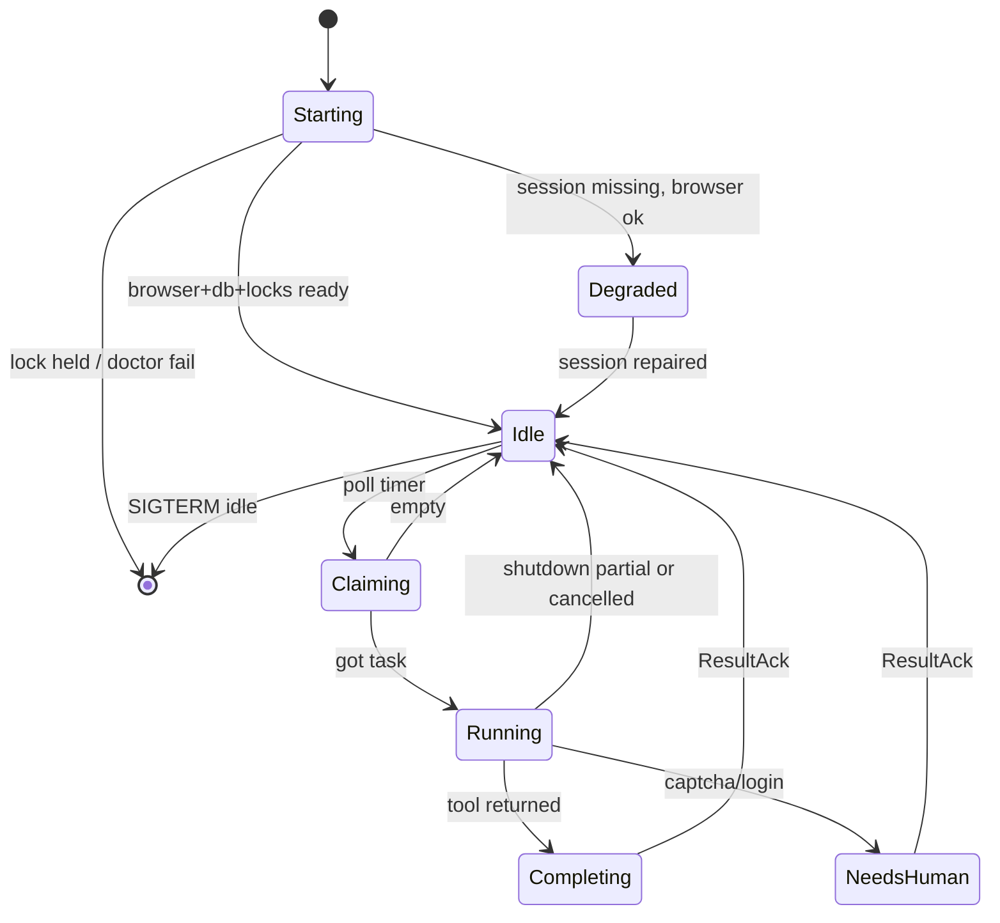
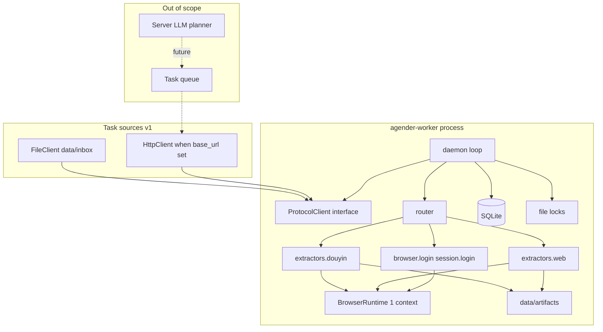
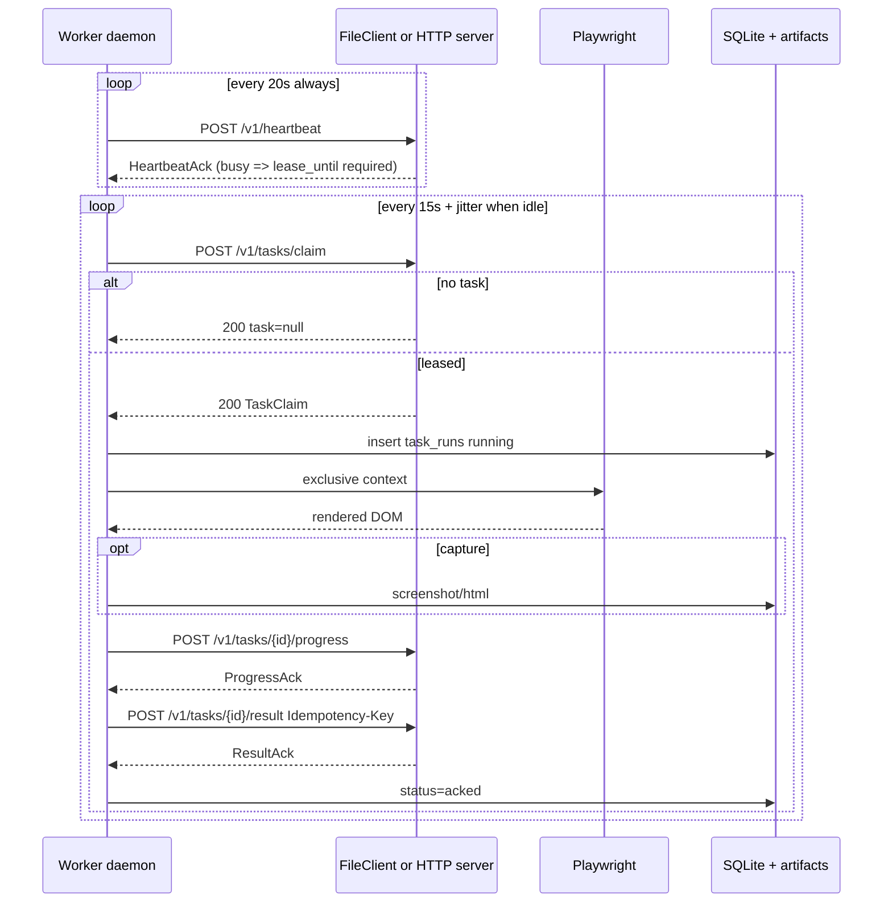

# Agender Worker 设计文档

| 字段 | 值 |
| --- | --- |
| 标题 | Agender Worker：抖音公开页浏览与 Web 热点/知识采集工具 |
| 作者 | Grok design-doc-writer |
| 日期 | 2026-09-11 |
| 状态 | Draft（rev 3，用户拍板开放问题） |
| 仓库 | `/Users/nikin/project/practice/agender`（greenfield：无源码、无 git；**本文是第一份文档**） |
| 范围 | **仅 Worker / 工具侧**；服务端 LLM 编排、任务规划、prompt、多租户控制面均不在本仓库实现 |
| CLI | 控制台脚本 **`agender-worker`**（避免与 `lot-agent/deploy/rust/agender` 撞名）；`python -m agender` 指向同一入口 |

---

## Overview

本仓库实现一个**无人值守的浏览采集 Worker**：用 Playwright 打开**公开网页**，抽取抖音视频的播放/互动数据与评论，或检索并阅读各站热点新闻与知识文章，再把结构化结果与可选产物回传。任务来源 v1 **同时实现** `FileClient`（联调默认）与 `HttpClient`（`AGENDER_SERVER_BASE_URL` 非空时启用）。服务端 LLM 负责「要不要继续下发任务」；Worker 只执行、只报告，**不自行规划下一跳**。抖音默认走**公开/匿名页**；需要登录时由 LLM 下发 `session.login`，在有头 Chrome 里走交互验证，会话写入 persistent profile，**密码不落盘**。

系统按「协议客户端 + 浏览器运行时 + 站点抽取器 + 本地状态」拆分。抖音走公开页**已渲染 DOM**（及页面内联的公开 SSR JSON），不逆向移动端私有 API、不伪造签名、不部署打码农场。反爬是一等风险：`douyin.video_comments` 在 v1 是 **best-effort**，常见终态可以是 `needs_human`，而不是保证可滚动评论。失败必须诚实上报 `blocked` / `needs_human`。

v1 运行假设：**操作员桌面上一份有头 Chrome**，单进程、单 profile 锁。不是云 VM 浏览器农场。

---

## Background & Motivation

### 要解决的问题

运营或研究场景需要周期性拿到两类公开信息：

1. **短视频侧**：某个关键词/作者/视频的播放量、点赞、评论数、分享、时长、作者信息，以及评论正文与互动。
2. **Web 研究侧**：在搜索引擎与资讯站上找热门新闻、知识长文，沉淀标题、URL、来源、时间、摘要/正文、相关链接。

这两类工作目前依赖人工打开浏览器复制粘贴，无法接入「服务端 LLM 定期下发任务 → 工具执行 → 反馈 → 决定是否续派」的闭环。

### 当前状态

- 本仓库无源码、无 git；**本文件为第一份文档**（`docs/DESIGN.md`）。
- 相邻项目 **不是依赖**：
  - `/Users/nikin/project/practice/lot-agent`：TypeScript 数字员工 / 营销 CRM，**禁止并入**。其 `deploy/rust/agender` 已是另一个名为 `agender` 的可执行文件（机器信息，`:8080`）。本仓库 CLI 因此使用 **`agender-worker`**。
  - `/Users/nikin/project/practice/charge`：Python + Playwright 充值工具。仅作浏览器运维**先验**，**不 import、不拷贝支付逻辑**。对照必须写清，避免 PR4 误搬：

    | 可借鉴（形状） | 不要复制 |
    | --- | --- |
    | `chromium.launch_persistent_context` | 默认 `ephemeral_profile=True` 的每单临时目录 |
    | `channel=chrome` 失败回退捆绑 Chromium | 随机 OS/UA 指纹池（`select_fingerprint`） |
    | SIGTERM 注册与主循环退出的**形状** | `SystemExit(0)` 直接丢掉在途任务（本 Worker 必须尽量提交 `partial`） |
    | — | `build_anti_detect_js`（webdriver / chrome.csi / plugins 补丁） |
    | — | 住宅代理池、`browser.proxy` 作为反检测依赖 |
    | — | `context.add_cookies` 注入 ChatGPT `sessionToken`（站点与语义都不同） |
    | — | **Playwright `storage_state=` 启动参数**（charge **零使用**；本设计也不用它启动 persistent context） |
    | — | 本地 SQLite 当**任务队列**（charge 的 `db.claim_next_order`）。本 Worker 的 SQLite 只记运行轨迹；任务来自 FileClient 或 HTTP |

  - 飞书内容工作流 `https://feishu.todoucloud.com`：独立系统；**v1 不做、不留集成桩**。

### 痛点

| 痛点 | 影响 |
| --- | --- |
| 抖音 Web 反爬强、登录墙、评论靠 SPA 滚动加载 | 评论是 best-effort；未登录不假装 `succeeded` + 空列表 |
| 站点 DOM 频繁改版 | 选择器隔离；先有脱敏 fixture 再写选择器（PR6a → 6b） |
| 无任务协议 | 需要**闭合**的 claim/heartbeat/result ACK，含租约续期 |
| 会话与密钥 | 登录态、Worker token、任务里偶发的密码不能进 git/日志/SQLite；profile 为唯一运行时真相 |
| 合规 | 评论含 PII；截图/HTML 可能含账号信息；必须有保留期与最小采集 |
| 同机重名 CLI | 不用 `agender` 作 console script |

---

## Goals & Non-Goals

### Goals（v1）

- 常驻 Worker 守护进程：心跳、租约抢占、执行、回传、崩溃恢复（单一恢复路径）。
- 一套 Worker 面向的任务/结果协议：Pydantic 模型 + **导出的 JSON Schema**（`docs/protocol.md` 为 PR2 合并门槛）。**FileClient 与 HttpClient 在 v1 都是完整实现**（同一接口；默认 FileClient）。
- 抖音公开页工具：搜索、按 URL/id 打开视频、抽播放数据（**默认匿名**）；**滚动评论为 best-effort**（有上限；无会话时 `needs_human` 是正常结果）。
- **按需登录**：任务类型 `session.login`（及同等 CLI）。LLM 可下发登录指令；有头窗口里操作员完成验证。不把未登录评论伪装成成功。
- Web 研究工具：默认 `search_engine=auto`（Bing CN，验证码/blocked 则自动切百度一次）+ 通用正文抽取；热榜 v1 **只交付 `baidu_hot` 一个适配器**。
- 单 Worker、**同一时刻仅 1 个 BrowserContext**；跨进程文件锁，禁止第二份 daemon 碰同一 profile/DB。
- 本地 SQLite 记录任务运行；产物落盘；可配置保留期。
- 结构化日志、运行轨迹、本机 loopback 指标。
- 防御性限速、站点隔离 profile、会话卫生；失败分类可被服务端 LLM 消费。

### Non-Goals

- 服务端 LLM、任务规划器、prompt 工程、多租户控制面、计费。
- 逆向抖音/今日头条私有 API、设备指纹 SDK、X-Gorgon/X-Argus/`a_bogus`/`X-Bogus` 一类签名、抓包重放、用 httpx 直接打 `/aweme/v1/web/*`。
- 打码平台、验证码农场、凭证填充、撞库、账号共享池、把密码重放当可靠性策略、绕过支付/会员墙的 exploit。
- 下载视频/音频码流（版权与存储；v1 只采元数据与评论文本）。
- 把本 Worker 并入 `lot-agent` 或复用其营销 CRM 数据模型。
- v1 必做 MCP Server、多 Worker 水平扩展、Kubernetes Operator、云端无头浏览器农场。
- v1 官方抖音/开放平台数据 API、飞书投递（**不留集成桩**）。
- HMAC / mTLS（v1 **仅 Bearer**）。
- 保证「对抖音反爬不可检测」或「评论字段稳定可抽」。
- 把 charge 的 JS 指纹补丁、代理池、临时指纹套装搬进本仓库。

---

## Proposed Design

### 1. 仓库布局与技术栈

推荐栈：**Python 3.12 + Playwright (async) + Pydantic v2 + httpx + aiosqlite + trafilatura + PyYAML + structlog + typer**，包管理用 **uv**（`pyproject.toml` + `uv.lock`）。CLI 框架选定 **typer**（不用 argparse）。

#### 目标目录（尚未创建，实施时按此落地）

```text
agender/
  pyproject.toml                 # scripts: agender-worker = agender.cli:app
  uv.lock
  README.md
  .gitignore                     # data/, .env, storage_state, config.yaml
  .github/workflows/ci.yml       # uv sync, ruff, pytest；无 live、不访问外网站点
  config/
    config.example.yaml          # 无密钥
  docs/
    DESIGN.md                    # 本文
    protocol.md                  # PR2 冻结契约 + JSON Schema 导出说明
    ops.md                       # PR8
  examples/
    web_search.json
    web_research.json
    web_fetch_article.json
    douyin_search.json
    douyin_video_stats.json
    session_login.json
  src/agender/
    __init__.py
    __main__.py                  # python -m agender → 与 agender-worker 同一入口
    cli.py                       # worker / run / session / gc / doctor
    config.py
    worker/
      daemon.py
      loop.py
      heartbeat.py
      router.py
    protocol/
      client.py                  # HttpClient
      file_client.py             # FileClient（v1 默认可运行路径）
      schemas.py
      jsonschema/                # PR2 从 Pydantic 导出的 *.json
      errors.py
    browser/
      runtime.py
      hygiene.py
      cookies.py
      login.py                   # session.login：公开表单填充 + 有头等待人工验证
      lock.py                    # 进程内 + 跨进程文件锁
    extractors/
      douyin/
        tool.py
        selectors.py
        normalize.py
      web/
        tool.py
        search_bing.py
        search_baidu.py
        article.py
        hotlists.py              # v1 仅 baidu_hot
        policy.py
    store/
      db.py
      artifacts.py
      retention.py
    obs/
      logging.py
      metrics.py
      traces.py
  tests/
    fixtures/html/               # 最小化、已脱敏 DOM 快照（不是 full page.content）
    protocol/
    extractors/
    worker/
  scripts/
    import_session.py
    capture_fixture.py           # 有头、手动、脱敏后写 fixture
  data/                          # gitignore
    inbox/tasks/                 # FileClient 入站
    outbox/results/
    outbox/artifacts/
    profiles/
    sessions/
    artifacts/
    agender.db
```

#### 为何选这套栈

| 需求 | Python+Playwright 的匹配 |
| --- | --- |
| 浏览器自动化 | Playwright Python async API 成熟；可 `channel=chrome` 复用本机 Chrome |
| 中文正文抽取 | `trafilatura` / `readability-lxml` |
| 协议与校验 | Pydantic v2 → JSON Schema 导出，给未来服务端，避免反推 Python |
| 单机状态 | `sqlite3` + `aiosqlite` |
| 先验 | charge 验证了 persistent context + chrome channel 可运维（按上表选择性借鉴） |

依赖意图：`playwright>=1.49`、`pydantic>=2.8`、`httpx>=0.27`、`aiosqlite>=0.20`、`trafilatura>=1.12`、`readability-lxml`、`pyyaml`、`structlog`、`prometheus-client`、`typer`。

### 2. 进程模型

**主路径：长驻 daemon**。v1 **FileClient 与 HttpClient 都实现**；未配置 `AGENDER_SERVER_BASE_URL` 时用 FileClient（联调默认），有 base_url 时用 HTTP。两者走同一 `ProtocolClient`，HTTP 是可 mock 的真客户端，不是空壳。

```text
agender-worker worker                 # 常驻（首选命令）
agender-worker run --file task.json   # 单次调试，不 claim
agender-worker session login --site douyin [--username ...]
agender-worker session import --site douyin --file path.json
agender-worker session export --site douyin --file path.json
agender-worker doctor
agender-worker gc
python -m agender <同上>              # 等价入口，文档不主推，以免与 lot-agent 的 agender 混淆
```

行为约定：

- 单进程、单 BrowserContext（`concurrency=1`）。
- **跨进程锁**：启动时对 `data/agender.db.lock` 与 `data/profiles/web.lock`、`data/profiles/douyin.lock` 取排他文件锁（PID + 启动时间写入）。锁已被活进程持有则拒绝启动。这是 persistent profile 的必然后果；charge 用临时目录回避了这个问题，我们不能。
- 轮询间隔默认 **15s + [0, 5s] jitter**（仅 **idle** 时 claim）。
- 心跳默认 **20s**（idle 与 busy 都发；busy 时心跳**必须**续租）。
- 抢到任务后停止 claim，直到 result 被 ACK 或本地判定 `LEASE_LOST`。
- 崩溃恢复见 §2.1（**只有一条路径**，禁止「提交 failed 同时又等重 claim 同一 attempt」）。
- SIGTERM/SIGINT：尽量提交 `partial` + `WORKER_SHUTDOWN` 或 `cancelled`（见成功矩阵），再关浏览器。charge 的 SIGTERM 是直接退出，**不是**本行为的范本。
- **MCP**：v1 不做。
- **one-shot CLI**：只用于开发与事故排查。
- **部署形态**：v1 = 操作员桌面、有头 Chrome、一人一机。不设计无头容器刷抖音。



#### 2.1 崩溃恢复（单一策略）

本地 `task_runs.status` 是**本地列**，不是协议 `ResultStatus`。取值：`running` | `submitting` | `acked` | `interrupted` | `superseded`。

启动时扫描 `status=running` 或 `submitting`：

| 本地行状态 | 动作 |
| --- | --- |
| `running`/`submitting` 且 `result_json` **非空** | 用同一 `Idempotency-Key: {task_id}:{attempt}` 再 POST result；ACK 后标 `acked` |
| `running` 且 `result_json` **为空** | 构造协议结果 `status=failed`，`error.code=WORKER_INTERRUPTED`，`retryable=true`，提交；本地标 `interrupted` |
| 服务端对提交返回 `409 LEASE_LOST` | 本地标 `superseded`，**丢弃**，不再重放 |
| 任何情况 | **禁止**用同一 `task_id+attempt` 再 claim / 再执行 |

表约束：`UNIQUE(task_id, attempt)`。新 attempt 只可能来自**服务端新 claim**（服务端自己递增 attempt）；Worker 不发明 attempt。

### 3. 总体架构



数据流：任务 JSON → 校验与限额裁剪 → 浏览器导航 → 抽取器产出规范化对象 → 本地落库/落盘 → 结果信封回传。**是否续派由服务端决定**。

### 4. 浏览器运行时

模块：`src/agender/browser/runtime.py`。

#### 启动策略

| 项 | v1 默认 |
| --- | --- |
| 引擎 | Playwright `chromium.launch_persistent_context`（**不用** `storage_state=` 启动参数） |
| channel | 优先本机 `chrome`，失败回退捆绑 Chromium |
| 并发 | **1 个 context / Worker** |
| Profile（运行时唯一真相） | `data/profiles/web`、`data/profiles/douyin` |
| locale / timezone | `zh-CN` / `Asia/Shanghai` |
| viewport | `1440x900`（与 UA/平台成套，禁止拆开随机） |
| Accept-Language | `zh-CN,zh;q=0.9,en;q=0.8` |
| slow_mo | 50ms |
| 动作间隔 | 均匀随机 800–2500ms |
| 导航超时 | 30s |
| headless | `auto`：Web 默认 true；抖音默认 **false（有头）** |

卫生措施（`hygiene.py`）= **普通中文桌面 Chrome 的默认参数清理**，**不声称隐身、不是 stealth 方案**：

- `ignore_default_args=["--enable-automation"]` 与 `--disable-blink-features=AutomationControlled`：去掉 Playwright/Chromium 默认打上的自动化开关，属于启动旗标清理。**禁止**再叠加 charge 的 `build_anti_detect_js`（webdriver getter、fake plugins、chrome.csi 等）。
- 固定 locale/tz/viewport/UA 成套。
- 滚动用多次小步 `mouse.wheel` + 随机停顿。
- **禁止** `wait_for_load_state("networkidle")`（抖音分析像素与 WebSocket 会让网络永不 idle）。等待一律用 **locator + 超时**（见 §5）。

明确不做：验证码识别、TLS 指纹伪造、WebGL 噪声、住宅代理池、CDP 绕检测、第三方 stealth 插件。

#### 会话：单一真相源（Key Decision）

**选用方案 A：persistent `user_data_dir` 是运行时唯一真相。** JSON 文件只是导入/导出备份，不是第二份 cookie 库，也不是 `launch_persistent_context(storage_state=...)`。

| 路径 | 角色 |
| --- | --- |
| `data/profiles/douyin` | **Canonical**。daemon 每次启动直接打开该目录。 |
| `data/sessions/douyin.storage_state.json` | Playwright `storage_state` 形状的**备份**（`cookies` + `origins`）。gitignore。 |

**导入策略（只在 CLI 或 profile 为空时发生，daemon 每次启动不重新 import）：**

1. `agender-worker session import --site douyin --file X.json`：读 JSON，允许 **`cookies[]` 与 `origins[]`（localStorage）**。用已启动的 persistent context 执行 `add_cookies`，并对 `origins` 里每个 origin 写 localStorage。然后 `storage_state()` 回写备份文件。拒绝非 JSON、拒绝把密码/二维码写进仓库。
2. **交互登录（CLI 与任务 `session.login` 共用 `browser/login.py`）** — 见下一小节。成功后从 profile `export` 备份 JSON。
3. `agender-worker session export`：从 **profile** dump 出 JSON 备份。
4. daemon 启动：若 profile 目录已存在则**不读** JSON。仅当 profile 不存在或 cookies 为空 **且** JSON 备份存在时，做一次自动 import（等同显式 import），并打日志 `session.seeded_from_backup`。
5. 运行中 cookie 刷新只留在 profile 内。备份 JSON 不会自动更新，除非操作员 `export` 或 `login`。

#### 按需交互登录（`session.login`）

**默认路径仍是公开/匿名页**，不要求事先登录。服务端 LLM 可以下发登录指令；Worker **不**把未登录重放密码当常规采集策略。v1 仅 `site=douyin`。同一时刻一机、一 profile、一次登录。

| 入口 | 行为 |
| --- | --- |
| `agender-worker session login --site douyin [--username U]` | 有头打开公开登录页；终端确认（Enter）才算 CLI 成功 |
| 任务 `type=session.login` | 同一套代码；DOM 启发式成功即 `succeeded`，超时 → `needs_human`/`LOGIN_WALL` |

步骤：

1. 打开抖音 **公开登录页**（有头，强制 `headless=false`）。禁止打私有 auth API、禁止伪造验证码。
2. `username` 可选：仅作表单提示，填入页面上可见的账号框。
3. `password` **可选、一次性**：若任务带了密码，只填公开密码框并尝试点页面上的登录按钮，然后**立即从内存丢掉**。禁止写入日志、SQLite `payload_json`（落库前改写为省略）、结果信封、artifacts、截图文件名、FileClient inbox 残留（claim 后从 inbox 文件抹掉该字段）。
4. 出现滑块 / SMS / 二维码：**停下来等操作员在真实 Chrome 窗口里完成**。代码不解题、不接打码平台、不轮询短信接口。
5. 登录成功判定**不是 URL**：顶栏头像 / 登录用户入口可见，或公开 SSR/内联 JSON 出现非空 `user_id`，且 cookie allowlist 达到 `sessions.douyin=ok`。CLI 额外要求终端 Enter。
6. 只把会话留在 persistent profile（cookie/localStorage）。**永不持久化密码。**

`session.login` **强制** `capture_screenshot=never`、`capture_html=never`（忽略任务里的 capture_*，避免拍到密码框）。默认软墙钟 **300s**（等人），硬顶仍 600s。

禁止：凭证填充/撞库、账号池、无人值守把密码重放当可用性手段、多开登录。

**过期检查（心跳用，不作为登录的唯一定义）** 读取 profile 内以下 **cookie name allowlist**（公开页常见名；PR6a fixture spike 若发现更名则改配置，不改协议）：

- `sessionid`
- `sid_tt`
- `uid_tt`
- `ttwid`

规则：`sessionid` 或 `sid_tt` 二者之一存在且 `expires` > now+5min → `sessions.douyin=ok`；cookie 全缺 → `missing`；有 name 但已过期 → `expired`。日志只记 **name 与过期时间**，永不记 value。

`sessions.web`：v1 无登录，恒为 `ok`（除非 profile 锁/损坏 → `unknown`）。

#### 心跳与 capability 的拆分

`browser_ready` **只**表示 Chromium 能拉起（doctor 的 launch 检查通过）。会话死、浏览器活：

```text
browser_ready=true
status=degraded
sessions.douyin=expired|missing
capabilities: douyin.search、douyin.video_stats（匿名）、session.login（供 LLM 补登录）
disabled_capabilities: douyin.video_comments、douyin.video_bundle
```

`video_bundle` / `video_comments` 仅当 `sessions.douyin=ok` 才出现在 capabilities。匿名 search/stats **始终可领**（在 `tools.douyin && tos_ack` 时）。`session.login` 在会话缺失或过期时**仍要广告**，否则 LLM 无法下发补登录。Web capability 不受抖音会话影响。

`tools.douyin=false` 或 `douyin.tos_ack=false`：所有 `douyin.*` 与 `session.login` 都不出现在 capabilities。

#### 站点切换

关当前 context，再开对应 profile。冷启动 2–5s 计入墙钟。文件锁在进程级持有，切换站点不释放 DB 锁。

### 5. 抖音工具

公开入口（URL 模板放配置）：

| 操作 | 公开 URL 形态 | 任务类型 | v1 承诺 |
| --- | --- | --- | --- |
| 搜索 | `https://www.douyin.com/search/{query}` | `douyin.search` | 尽力；匿名常缺播放量 |
| 打开视频 | `https://www.douyin.com/video/{id}` 或分享短链 | `douyin.video_stats` | 身份+标题即可 `succeeded`；`play_count` 允许 null |
| 评论 | 同视频页，滚动已渲染评论节点 | `douyin.video_comments` | **best-effort**；无会话 → `needs_human`/`LOGIN_WALL` |
| 合绑 | 同一页先 stats 再 comments | `douyin.video_bundle` | 需要会话；软墙钟 240s；默认 20 条评论 |
| 按需登录 | 公开登录页 + 有头人工验证 | `session.login` | 默认不登录；LLM 下发才跑；密码不落盘 |
| 图文 | `https://www.douyin.com/note/{id}` | — | **v1 不支持** → `failed`/`UNSUPPORTED_URL` |
| 作者页 | `/user/{sec_uid}` | — | 非 v1 |

#### 短链与跳转 allowlist

`https://v.douyin.com/...` 的公开 302 经常经过 `www.iesdouyin.com/share/video/{id}`，再落到桌面 `www.douyin.com/video/{id}` 或带 `modal_id` 的首页。**每一跳**（含 3xx Location）的 host 必须 ∈：

```text
v.douyin.com
www.douyin.com
www.iesdouyin.com
```

禁止其它 ByteDance 域、任意第三方。最多 **5** 跳。能从路径或 query（`modal_id`、`/video/{id}`、`/share/video/{id}`）解析出数字 id 则规范化为 `https://www.douyin.com/video/{id}` 再抽。解析不到 id 且最终落点不是 `/video/{id}` → `failed`/`UNSUPPORTED_URL`。`/note/` 一律 `UNSUPPORTED_URL`，不要当视频解析。

#### 抽取策略（允许 vs 禁止）

- **允许**：渲染后 DOM 可见节点与属性；页面**已经内联**在 HTML 里的 SSR JSON。滚动评论面板，读**页面自己渲染出来的**评论节点。
- **允许（调试）**：Playwright 里观察页面**自己发起**的 XHR 的 path（例如日志里只打 `/aweme/v1/web/comment/list/` 这种 path，**去掉 query**），仅用于 PR6a 理解「面板何时出现」。
- **禁止**：用 httpx/Playwright request 重放、补 `a_bogus`/`X-Bogus`、构造 cookie 签名、把响应 JSON 当「非 DOM」主抽取路径。PR6 的实现规则一句话：**只读页面已经画出来的节点；不要伪造签名，不要从 Worker 里直接调用 aweme API。**

选择器放 `extractors/douyin/selectors.py`，`selector_pack_version` 默认从配置读取（例 `2026-09-11`）。无 live 站点时 PR6b 不得合并：必须先有 PR6a 的脱敏 fixture。

#### 等待，而不是 networkidle

| 步骤 | 等待条件 | 超时 |
| --- | --- | --- |
| 搜索卡片 | 至少 1 个视频卡片 locator，或登录墙/验证码 locator | 15s |
| 视频主信息 | 标题或作者 nickname locator | 15s |
| 评论面板 | 评论列表容器 locator | 8s；失败即走 LOGIN_WALL/EMPTY_RENDER 分类 |
| 评论滚动一轮 | **评论 item 数量增加**，或 8s 内不增加 → 本轮无新增 | 8s / 轮 |

连续 3 轮无新增 → `exhausted=true`。

#### 匿名 vs 登录（PR6a 必须实测填表；下列是实施前的**工作假设**）

| 字段 | 未登录 | 已登录 |
| --- | --- | --- |
| title、author.nickname、canonical url | 常可得 | 可得 |
| like/comment/share 文案 | 常可得 | 可得 |
| `stats.play_count` | **常常缺失 → null，仍可 `succeeded`** | 可能可见 |
| 评论列表节点 | 面板常不挂载 / 登录墙 | 可滚动 |

PR6a 产出：`docs/douyin-field-matrix.md` + fixture。矩阵与上表冲突时**以 PR6a 为准**改选择器，不改协议信封。

#### 操作细节

**search**：`goto` 搜索 URL → 等卡片或墙 → 滚动最多 `max_results`（默认 12，最大 30）。

**video_stats**：规范化 URL → 打开 `/video/{id}` → 抽字段。`play_count` 不可见 → `null` + `missing_fields`，只要身份+标题在，就是 `succeeded`（见成功矩阵）。

**video_comments**：

- `sessions.douyin != ok`：**不要滚**，立即 `needs_human` / `LOGIN_WALL`，`comments=[]`。**禁止** `succeeded` + 空评论冒充「视频没人评」。
- 会话 ok 但面板 8s 未挂载：`needs_human` 或 `EMPTY_RENDER`/`CAPTCHA`（按同时出现的 locator）。
- 会话 ok 且面板在、滚动后 0 条且 exhausted：`succeeded`（真的无评论），`returned=0`。
- 默认 `max_comments=20`（硬顶仍 200）。`include_replies` 默认 false。

**video_bundle**：一次打开。默认 `max_comments=20`。软墙钟 **240s**（见限额）。先写 stats 再滚评论；墙钟到了带已有 comments 返回 `partial`。

**session.login**：见 §4；不是抽取器。无会话时评论任务不要自己去登录，只报 `LOGIN_WALL`，让 LLM 决定是否派 `session.login`。

#### 失败分类（抖音）

| error.code | 典型现象 | 结果 status | retryable |
| --- | --- | --- | --- |
| `NAVIGATION_TIMEOUT` | 30s 未完成导航 | `failed` | true |
| `LOGIN_WALL` | 强制扫码/登录；评论面板不挂载 | `needs_human` | false |
| `CAPTCHA` | 验证码或滑块 | `needs_human` | false |
| `EMPTY_RENDER` | 白屏、根节点空 | `blocked` | true |
| `REGION_BLOCK` | 非服务区域 | `blocked` | false |
| `SELECTOR_DRIFT` | 有内容但对不上选择器 | 有任意已抽取记录 → `partial`；否则 `failed` | false |
| `COMMENT_LOAD_STALL` | 评论只加载部分 | `partial` | true |
| `SESSION_EXPIRED` | allowlist cookie 过期 | `needs_human` | false |
| `RATE_LIMITED` | 频控 / HTTP 429 | `blocked` | true |
| `UNSUPPORTED_URL` | `/note/`、短链无法规范化、跳转出 allowlist | `failed` | false |
| `UNSUPPORTED_TYPE` | claim 到未知 type | `failed` | false |
| `INVALID_PARAMS` | 参数校验失败 | `failed` | false |
| `SCHEMA_MISMATCH` | `schema_version` 不兼容 | `failed` | false |
| `POLICY_DENIED` | 未 `tos_ack`、denylist、robots | `failed` 或条目 `skipped` | false |
| `DEADLINE_SOFT` | 软墙钟，已有部分数据 | `partial` | false |
| `DEADLINE_HARD` | 硬杀 | 有数据 → `partial`；无数据 → `failed` | false |
| `WORKER_SHUTDOWN` | SIGTERM | 有可抽取记录 → `partial`；否则 `cancelled` | false |
| `WORKER_INTERRUPTED` | 进程崩溃恢复且无 result blob | `failed` | true |
| `LEASE_LOST` | 409 或心跳未续上 | 有数据 → `partial`；否则 `failed` | false |

熔断：同一站点连续 **5** 次 `blocked`/`CAPTCHA`，该 capability cooldown **30 分钟**。

### 6. Web 研究工具

#### 搜索适配器

| 优先级 | adapter id | 入口 | 说明 |
| --- | --- | --- | --- |
| `auto` 首选 | `bing_cn` | `https://cn.bing.com/search?q=` | |
| `auto` 回退 | `baidu` | `https://www.baidu.com/s?wd=` | Bing 验证码/blocked 后试一次 |
| 不进 v1 | `sogou` / `360` / Google | — | |

`search_engine: "bing_cn" | "baidu" | "auto"`。**默认 `auto`**（拍板）：先 Bing CN；若页面为验证码/`blocked`，**自动切百度 SERP 一次**，结果里记 `engine_used` 与 `engine_fallback=true`。两边都 blocked/验证码 → 整任务 `needs_human` + `CAPTCHA`（不再对同一引擎死磕）。显式 `"bing_cn"` / `"baidu"` 则不自动切换。

#### 通用正文抽取

`trafilatura` 为主，`readability-lxml` 回退。`body_text` 截断至配置 `max_body_chars`（默认 20_000），超额 `truncated=true`。`related_urls` 最多 10 条同源。

软墙钟到达时：**停止再 `goto` 新 URL**，未开始的 document `fetch_status=skipped`，整任务 `partial` + `DEADLINE_SOFT`。

#### 热榜（v1 完成定义）

**v1 done = 仅 `baidu_hot`。** 其它 id 可写在配置里但 `enabled: false`，**不得**出现在 heartbeat `capabilities`，否则服务端会 claim 做不到的活。

URL **只放配置，不写死在代码**：

| id | v1 | 配置键默认 URL（公开页，可能改版） |
| --- | --- | --- |
| `baidu_hot` | 是 | `https://top.baidu.com/board?tab=realtime` |
| `sina_news` | 否 | `https://news.sina.com.cn/`（占位，enabled=false） |
| `toutiao_hot` | 否 | 不填；反爬/登录重 |
| `zhihu_hot` | 否 | 不填；常登录墙 |

每个 enabled 适配器必须有一条最小化 HTML fixture。`web.hot_list` capability 仅当 `tools.web=true` **且** 至少 1 个 hot_list `enabled=true` 且 doctor 未把该适配器标红。

#### 策略与限额

- **allowlist**：任务可追加。未知域默认允许 **http(s) GET 公开文章**，但先过 denylist 与 SSRF 检查。
- **denylist**（默认，DNS 解析后对 **每个跳转目标** 再查一次）：
  - 主机名：`localhost`、`metadata.google.internal`、`*.internal`、`*.localhost`
  - CIDR：`127.0.0.0/8`、`10.0.0.0/8`、`172.16.0.0/12`、`192.168.0.0/16`、`169.254.0.0/16`、`100.64.0.0/10`、`::1/128`、`fe80::/10`、`fc00::/7`、IPv4-mapped IPv6（`::ffff:0:0/96` 映射后再套用 IPv4 规则）
- **`.gov.cn`**：v1 **拒绝全部** `gov.cn` 与 `*.gov.cn`（含新闻站）。需要时由任务 `allowlist` **显式列出 FQDN** 才能放行。不搞 `/admin` 路径猜测。
- **重定向**：Playwright `goto` 与 httpx 跟随 3xx 时，对 **每一跳 Location 做 DNS 再 denylist**。命中则中止，该 URL `fetch_status=failed` / `POLICY_DENIED`。
- **robots.txt**：Web 默认 `respect_robots=true`。用 **httpx** 拉 robots（独立缓存 TTL 6h，**不计** `per_host_rpm`，也不走抖音 rpm）。不共用浏览器 cookie。Disallow 且未覆盖 → 该 URL `skipped` + `POLICY_ROBOTS`。
- **任务级 `respect_robots=false` 允许**（拍板）：仍拉 robots 以便判断「本会被拦」，但继续抓取，并写结构化事件 `policy.robots_bypassed`（`task_id`、`url`、`source=task_param`）。默认 true；覆盖必须出现在任务 params，不在全局 yaml 里默默关掉。
- 抖音任务不走 robots 自动放行；必须 `douyin.tos_ack=true`。
- 每任务最多 **20 URL**。
- **v1 `web.research` 默认：`max_pages=2`，`max_articles=3`**（避免 5×页 + 8×正文在 10 rpm 与 20s/URL 下打穿 180s 软墙）。
- 单页 HTML 落盘上限 **2 MiB**。
- 不提交表单、不登录第三方。

### 7. 任务执行流水线



墙钟：

| 任务类型 | 默认软墙钟 `timeout_s` | 硬顶 |
| --- | --- | --- |
| `web.search` / `web.fetch_article` / `web.hot_list` | 180s | 600s |
| `web.research` | 180s（默认只 2 页 + 3 篇，应能进 `succeeded`） | 600s |
| `douyin.search` / `douyin.video_stats` | 180s | 600s |
| `douyin.video_comments` / `douyin.video_bundle` | **240s** | 600s |
| `session.login` | **300s**（等人） | 600s |

Worker 实际截止 = `min(params.timeout_s, task.deadline_at-now, type默认, 600s)`。软限到：停导航、打包已有数据 → `partial`/`DEADLINE_SOFT`。硬限：杀页面；有数据 `partial`/`DEADLINE_HARD`，无数据 `failed`/`DEADLINE_HARD`。

---

## API / Interface Changes

本仓库实现 **ProtocolClient 接口** 的两个适配器：

1. **`FileClient`（联调默认）**：`server.base_url` 为空或未设 `AGENDER_SERVER_BASE_URL` 时启用。任务放 `data/inbox/tasks/*.json`，结果写 `data/outbox/results/{task_id}.json`。claim 读入后立刻从 inbox 文件删除 `params.password`（改写或移走），避免密码留在磁盘队列。
2. **`HttpClient`（v1 同样交付）**：`AGENDER_SERVER_BASE_URL` 非空时启用。真 HTTP 客户端（pytest-httpx 可 mock），不是 stub。下列契约是给未来服务端的闭合合同。PR2 必须把同一套 Pydantic 模型导出到 `src/agender/protocol/jsonschema/` 并在 `docs/protocol.md` 冻结。**合并门槛**：所有下方类型都有请求/响应 JSON，单测覆盖空队列、续租、409、未知 type、**两种 transport**。

`schema_version` 当前 **`"1.0"`**。Worker 对不等于 `1.0` 且主版本 >1 的任务：提交 `failed`/`SCHEMA_MISMATCH`，不执行。

### 认证与公共头（仅 HttpClient）

```http
Authorization: Bearer <worker_token>
X-Worker-Id: worker-01
X-Worker-Version: 0.1.0
Accept: application/json
Content-Type: application/json
Idempotency-Key: {task_id}:{attempt}    # 仅 result（及 artifact meta 重试）
```

- Token 只来自 `AGENDER_WORKER_TOKEN` 或 `server.token_file`。**禁止 yaml 明文**。
- v1 **仅 Bearer**。不把 HMAC/mTLS 写成必选或预留必做项。
- **幂等键只由 Worker 按 `{task_id}:{attempt}` 计算。** 任务 JSON 里若带 `idempotency_key` 字段，Worker **忽略**（避免与 header 分叉）。服务端应用 header。

### HTTP 状态 → 协议错误

| HTTP | 客户端 `error.code` | 行为 |
| --- | --- | --- |
| 200 | — | 解析 body |
| 204 | 不用于本协议 | 若出现当 200+空任务处理仅 claim；其它端点当 `UNAVAILABLE` |
| 401 / 403 | `UNAUTHORIZED` | 停 daemon |
| **409** | **`LEASE_LOST`** | 停止当前任务；按成功矩阵提交或丢弃；本地 `superseded` |
| 413 | `PAYLOAD_TOO_LARGE` | 去掉 artifacts 再提交一次 result；仍失败则 `failed` |
| 422 | `INVALID_PARAMS` | claim 体或 result 体不被接受；不要死循环 |
| 429 | `RATE_LIMITED` | 退避 |
| 5xx | `UNAVAILABLE` | 指数退避 1s,2s,4s,8s × 最多 4 次 |

连接 5s，读写 30s。

### 端点一览

| 方法 | 路径 | 何时 | 成功 body | 幂等 |
| --- | --- | --- | --- | --- |
| `POST` | `/v1/heartbeat` | 每 20s | `HeartbeatAck` | 是 |
| `POST` | `/v1/tasks/claim` | idle 轮询 | `TaskClaim`（`task` 可 null） | 否（服务端原子租约） |
| `POST` | `/v1/tasks/{task_id}/progress` | 可选 | `ProgressAck` | 按 `seq` 覆盖 |
| `POST` | `/v1/tasks/{task_id}/result` | 终态 | `ResultAck` | `Idempotency-Key` |
| `POST` | `/v1/artifacts` | 仅当 `upload_artifacts=always` 或 `on_failure` 且当前有产物 **且** HttpClient 已启用 | `ArtifactUploadResponse` | 按 sha256 |

v1 **产物只留本机磁盘**（拍板）：即使 params 要求 upload，客户端 **no-op**，`uploaded=false`。协议保留 `POST /v1/artifacts` 以免以后改 schema，v1 **不调用**。

### 服务端派发约束（给未来 server 的 MUST）

- 只应派发 `task.type ∈ 最近一次心跳的 capabilities`（且不在 `disabled_capabilities`）。
- 若仍派到未知或不在 capabilities 的 type：Worker **仍要提交 result**，`status=failed`，`error.code=UNSUPPORTED_TYPE`，`retryable=false`。**禁止**静默 ACK、禁止丢弃无结果。
- `params` 校验失败：`failed`/`INVALID_PARAMS`。
- `max_tasks`：Worker **永远发送 `1`**。若服务端返回多个任务（非本 schema），只取 `task` 单对象；多出来的忽略并打 error 日志。

### Heartbeat 请求

`POST /v1/heartbeat`

```json
{
  "schema_version": "1.0",
  "worker_id": "worker-01",
  "status": "idle",
  "current_task_id": null,
  "lease_id": null,
  "browser_ready": true,
  "sessions": {
    "douyin": "ok",
    "web": "ok"
  },
  "capabilities": [
    "web.search",
    "web.fetch_article",
    "web.research",
    "session.login",
    "douyin.search",
    "douyin.video_stats"
  ],
  "disabled_capabilities": [
    "douyin.video_comments",
    "douyin.video_bundle"
  ],
  "metrics": {
    "uptime_s": 3600,
    "tasks_completed": 12,
    "blocked_rate_1h": 0.08
  }
}
```

- `status`：`idle` | `busy` | `degraded` | `stopping`
- `sessions.*`：`ok` | `expired` | `missing` | `unknown`
- **`blocked_rate_1h`**：过去 3600s 内 **已结束任务** 中 `status=blocked` 的比例。分母为该窗口 `acked` 的任务数；分母为 0 时发送 `0.0`。不是 navigation 计数。
- `busy` 时 `current_task_id` 与 `lease_id` **必填**（claim 返回的 lease_id）。

`web.hot_list` / `douyin.*` 按 §4–§6 的开关与会话计算后再填入数组，不要把做不到的 type 广告出去。

### HeartbeatAck（闭合）

```json
{
  "schema_version": "1.0",
  "ok": true,
  "server_time": "2026-09-11T12:00:20Z",
  "lease": {
    "lease_id": "lease_abc",
    "lease_until": "2026-09-11T12:04:20Z"
  },
  "stop": false
}
```

| Worker 状态 | `lease` 字段 |
| --- | --- |
| idle / degraded 无任务 | **必须为 `null`** |
| busy | **必须非空**。`lease_id` 与请求一致。`lease_until`（UTC）必须 `>= min(now+240s, task.deadline_at+60s)` 与 `>= now+heartbeat_interval_s*3` 二者之中对 Worker 更安全的那个：即至少续到 **now + 240s**，但服务端可以把硬截止对齐到 `deadline_at+60s`。 |

**续租是 busy 心跳的硬性契约。** 默认 claim 租约 240s，硬墙钟 600s；若不续租，`video_bundle` 会在 4 分钟被服务端回收 —— 这是协议 bug，不是运维边角。Worker 算法：

1. claim 得到 `lease.lease_until`。
2. 每 20s heartbeat（busy）带上 `lease_id`。
3. 用 Ack 的 `lease_until` 覆盖本地。
4. 若 Ack 缺 `lease`、或 `lease_until < now+30s`、或 HTTP 409 → 视为 `LEASE_LOST`：停止导航，按成功矩阵打包（有数据 `partial`，无数据 `failed`），若 409 则**不要**再 POST result（服务端已回收）；若只是续租失败但 HTTP 200 畸形，仍尝试提交 result 一次。
5. FileClient：本地把 lease_until 每次心跳 +240s，不存在 409。

`stop: true`：Worker 在当前任务结束后退出（用于未来运维）。

### Claim 请求 / 响应 / 错误

`POST /v1/tasks/claim`

```json
{
  "schema_version": "1.0",
  "worker_id": "worker-01",
  "capabilities": ["web.research"],
  "max_tasks": 1
}
```

`max_tasks` 唯一合法值：**1**。客户端校验，不是 1 就拒绝启动或改写为 1。

成功 200 空队列：

```json
{
  "schema_version": "1.0",
  "task": null,
  "lease": null
}
```

成功 200 有任务：

```json
{
  "schema_version": "1.0",
  "lease": {
    "lease_id": "lease_abc",
    "lease_until": "2026-09-11T12:04:00Z",
    "heartbeat_s": 20
  },
  "task": {
    "schema_version": "1.0",
    "task_id": "tsk_01HZX",
    "type": "web.research",
    "priority": 10,
    "attempt": 1,
    "created_at": "2026-09-11T12:00:00Z",
    "deadline_at": "2026-09-11T12:10:00Z",
    "params": {}
  }
}
```

- `priority`：Worker **忽略**（不排序；一次只领一条）。
- `attempt`：缺省当 1。写入 Idempotency-Key。
- Claim 错误 body（非 200）：

```json
{
  "schema_version": "1.0",
  "code": "UNAUTHORIZED",
  "message": "invalid worker token",
  "retryable": false
}
```

409 claim：该 worker 已有未完成租约（`LEASE_LOST` 或继续心跳等回收，不并行执行第二个任务）。

### Progress / ProgressAck

请求：

```json
{
  "schema_version": "1.0",
  "task_id": "tsk_01HZX",
  "lease_id": "lease_abc",
  "seq": 3,
  "message": "scrolled comments",
  "counts": { "comments": 24 }
}
```

响应 `ProgressAck`：

```json
{
  "schema_version": "1.0",
  "ok": true,
  "task_id": "tsk_01HZX",
  "seq": 3
}
```

FileClient：追加到 `data/outbox/progress.jsonl`。HttpClient 409 → `LEASE_LOST`。

### TaskResult / ResultAck

`POST /v1/tasks/{task_id}/result`

请求信封：

```json
{
  "schema_version": "1.0",
  "task_id": "tsk_01HZX",
  "worker_id": "worker-01",
  "attempt": 1,
  "lease_id": "lease_abc",
  "status": "partial",
  "started_at": "2026-09-11T12:00:01Z",
  "finished_at": "2026-09-11T12:01:22Z",
  "duration_ms": 81000,
  "result": { "kind": "web.research" },
  "error": {
    "code": "DEADLINE_SOFT",
    "message": "soft wall clock reached; 1 article skipped",
    "retryable": false,
    "details": { "skipped": 1 }
  },
  "artifacts": [],
  "hints_for_planner": {
    "suggested_followups": [],
    "blockers": []
  }
}
```

`ResultAck`：

```json
{
  "schema_version": "1.0",
  "ok": true,
  "task_id": "tsk_01HZX",
  "accepted_status": "partial",
  "duplicate": false
}
```

`duplicate: true` 表示幂等重放已接受，Worker 把本地标 `acked`。

### Artifact 上传（schema 保留，v1 客户端可 no-op）

`POST /v1/artifacts`  
`Content-Type: multipart/form-data`

| part | 内容 |
| --- | --- |
| `meta` | JSON：`{schema_version, task_id, attempt, artifact_id, kind, content_type, sha256, bytes}` |
| `blob` | 原始字节 |

- 最大 **5 MiB**；超过不上传，result 里 `uploaded=false`。
- `sha256` 在 **meta JSON** 内，不是 query。
- 响应 `ArtifactUploadResponse`：

```json
{
  "schema_version": "1.0",
  "ok": true,
  "artifact_id": "art_01",
  "sha256": "hex",
  "stored": true
}
```

v1：不调用该端点，`uploaded=false`，blob 只在 `data/artifacts`。

### 公共 params

| 字段 | 类型 | 默认 | 说明 |
| --- | --- | --- | --- |
| `timeout_s` | int | 见类型表 | clamp 到 `[30, 600]` |
| `capture_screenshot` | `"never"` \| `"on_failure"` \| `"always"` | `on_failure` | |
| `capture_html` | `"never"` \| `"on_failure"` \| `"always"` | `never` | 与 screenshot **同一枚举**（不再用 bool） |
| `upload_artifacts` | `"never"` \| `"on_failure"` \| `"always"` | `never` | v1 客户端 no-op，`uploaded=false` |
| `respect_robots` | bool | `true`（仅 Web 任务） | `false` 允许，但必须打 `policy.robots_bypassed` 审计事件 |
| `redact_commenters` | bool | **false**（结果载荷） | `true` 时结果里去掉 `user_id`/`sec_uid`/`avatar_url`；**日志始终截断/脱敏** |
| `locale` | string | `zh-CN` | 不得撕裂 profile |

### 任务类型 params

#### `douyin.search`

```json
{ "query": "新能源汽车 试驾", "max_results": 12, "sort": "general" }
```

#### `douyin.video_stats`

```json
{ "url": "https://www.douyin.com/video/7123456789012345678", "video_id": null }
```

`url` 与 `video_id` 至少一个。示例 id 为 **19 位虚构数字**，非真实视频。

#### `douyin.video_comments`

```json
{
  "url": "https://www.douyin.com/video/7123456789012345678",
  "max_comments": 20,
  "include_replies": false,
  "max_replies_per_comment": 5,
  "redact_commenters": false
}
```

Worker 将 `max_comments` clamp 到 `[1, 200]`；**默认 20**。

#### `douyin.video_bundle`

stats + comments 参数并集；默认 `max_comments=20`，默认软墙钟 240s。

#### `session.login`

```json
{
  "site": "douyin",
  "username": "optional_hint",
  "password": null,
  "timeout_s": 300
}
```

- `site` v1 只接受 `"douyin"`，其它 → `INVALID_PARAMS`。
- `username` 可选，可出现在结果的 `username_hint_used`（布尔），**不要回传用户名明文**（可用 `username_present: true`）。
- `password` 可选。协议允许 planner 放进 payload **一次**；Worker 填完公开表单即从内存清除。落盘前从 `payload_json` 删除该键。
- 默认 `timeout_s=300`。`capture_*` 被强制 `never`。

#### `web.search`

```json
{
  "query": "2026 固态电池 量产",
  "search_engine": "auto",
  "max_pages": 2,
  "allowlist": ["*.jiemian.com", "www.36kr.com"],
  "denylist": [],
  "respect_robots": true
}
```

默认 `max_pages=2`（最大仍 5，任务可上调）。`search_engine` 缺省 **`auto`**。

#### `web.fetch_article`

```json
{
  "urls": ["https://example.com/a"],
  "include_body": true,
  "max_body_chars": 20000
}
```

URL 数 clamp 到 20。

#### `web.hot_list`

```json
{ "sources": ["baidu_hot"], "max_items_per_source": 20 }
```

未知或 disabled source → 该 source `status=skipped`，不把整个 capability 当成功广告。

#### `web.research`

```json
{
  "query": "地方银行 高股息",
  "search_engine": "auto",
  "max_pages": 2,
  "max_articles": 3,
  "include_body": true,
  "allowlist": [],
  "denylist": [],
  "respect_robots": true
}
```

### 关键接口

```python
class TaskType(str, Enum):
    DOUYIN_SEARCH = "douyin.search"
    DOUYIN_VIDEO_STATS = "douyin.video_stats"
    DOUYIN_VIDEO_COMMENTS = "douyin.video_comments"
    DOUYIN_VIDEO_BUNDLE = "douyin.video_bundle"
    SESSION_LOGIN = "session.login"
    WEB_SEARCH = "web.search"
    WEB_FETCH_ARTICLE = "web.fetch_article"
    WEB_HOT_LIST = "web.hot_list"
    WEB_RESEARCH = "web.research"

class ResultStatus(str, Enum):
    SUCCEEDED = "succeeded"
    PARTIAL = "partial"
    FAILED = "failed"
    BLOCKED = "blocked"
    NEEDS_HUMAN = "needs_human"
    CANCELLED = "cancelled"

class ProtocolClient(Protocol):
    async def heartbeat(self, body: Heartbeat) -> HeartbeatAck: ...
    async def claim(self, body: ClaimRequest) -> TaskClaim: ...
    async def progress(self, task_id: str, body: Progress) -> ProgressAck: ...
    async def submit_result(self, body: TaskResult) -> ResultAck: ...
    async def upload_artifact(self, meta: ArtifactMeta, blob: bytes) -> ArtifactUploadResponse: ...
```

claim 之后未知 `type` / 坏 params / 坏 schema：**必须** `submit_result`，不得只 ACK claim。

---

## Data Model Changes

### `video_id` vs `aweme_id`

抖音 Web 路径里的数字 id 通常就是 aweme id。协议保留两字段：`video_id` = URL 路径 id（规范化后）；`aweme_id` = 页面内联数据里若出现的同义字段。若只得到一个，**两个字段填相同字符串**。不是两种对象。

### 成功矩阵（`succeeded` / `partial` / 其它）

「要求的字段按限额收齐」以此表为准。`null` 表示允许缺失，**禁止用 0 表示缺失**。

| type | `succeeded` 当且仅当 | 允许 null / 空 | 翻成 `partial` | 其它终态 |
| --- | --- | --- | --- | --- |
| `douyin.search` | 搜索页渲染且解析流程完成（含 0 条真实空结果） | 卡片缺 `video_id`、缺 play_count | 有卡片但全部缺 url | 墙 → 分类码 |
| `douyin.video_stats` | 已规范化 `video_id` **且** `title` 非空 **且** `author.nickname` 非空 | **`stats.play_count` 及所有计数**、`published_at`、`author.user_id`/`sec_uid`/`follower_count`、`music.*` | 有 `video_id` 但缺 title 或 nickname | 打不开 → failed/blocked |
| `douyin.video_comments` | 面板挂载且（`returned>=min(max_comments, available)` 或 `exhausted=true`） | 单条缺 like_count/created_at | stall（有评论未到上限且未 exhausted） | 无会话或面板不挂载 → **`needs_human`/`LOGIN_WALL`，不是 succeeded+[]** |
| `douyin.video_bundle` | stats 达到其 `succeeded` **且** comments 达到其 `succeeded` | 同子任务 | stats ok 但评论 stall/软墙钟 | 评论 LOGIN_WALL → `needs_human`，但 `result.video` 仍填已抽 stats |
| `web.search` | SERP 解析完成（0 命中也算） | snippet 空 | 只解析到半页然后漂移 | `auto` 下 Bing+百度均验证码/blocked → **`needs_human`/`CAPTCHA`** |
| `web.fetch_article` | 每个输入 URL 的 `fetch_status ∈ {ok, skipped}` 且至少 1 个 `ok` 或全部因 robots skip | body 截断 | 部分 `failed`/`blocked` 且至少 1 个 ok | 全部 failed → `failed` |
| `web.hot_list` | 至少一个 enabled source 返回 `items.length>=1` 或该榜合法空 | 单源失败 | 部分 source `blocked`/`failed` 且至少一源 ok | 全部失败 |
| `web.research` | SERP `succeeded` 且计划抓取的文章均 `ok` 或 policy `skipped` | 同 article | 软墙钟留下 `skipped`；部分 fetch 失败 | 双引擎验证码 → `needs_human`/`CAPTCHA`；其它搜索失败 → `blocked` |
| `session.login` | `sessions.douyin=ok`（cookie allowlist）**且**登录 DOM 启发式成立 | 无密码、无 cookie value | — | 超时/验证码未完成 → `needs_human`/`LOGIN_WALL` 或 `CAPTCHA`；导航失败 → `failed` |

**可抽取记录**：任意已解析的 SERP 行、document、video 身份、或评论 1 条。

| 事件 | 有可抽取记录 | 无可抽取记录 |
| --- | --- | --- |
| 软墙钟 | `partial` + `DEADLINE_SOFT` | `failed` + `DEADLINE_SOFT` |
| 硬墙钟 | `partial` + `DEADLINE_HARD` | `failed` + `DEADLINE_HARD` |
| SIGTERM | `partial` + `WORKER_SHUTDOWN` | **`cancelled`** + `WORKER_SHUTDOWN` |
| `LEASE_LOST` 且尚未 409 到 result | `partial` + `LEASE_LOST` | `failed` + `LEASE_LOST` |
| `SELECTOR_DRIFT` | `partial` | `failed` |

`cancelled` **没有**「几乎」：阈值为 **0 条可抽取记录**。

### 各 `TaskType` 的 `result` 信封

每种 `result.kind` 等于任务 type。

#### `douyin.video_stats`

```json
{
  "kind": "douyin.video_stats",
  "video_id": "7123456789012345678",
  "aweme_id": "7123456789012345678",
  "url": "https://www.douyin.com/video/7123456789012345678",
  "canonical_url": "https://www.douyin.com/video/7123456789012345678",
  "title": "...",
  "description": "...",
  "duration_ms": 15200,
  "cover_url": "https://...",
  "published_at": null,
  "author": {
    "user_id": null,
    "sec_uid": null,
    "unique_id": "example",
    "nickname": "示例作者",
    "follower_count": null
  },
  "stats": {
    "play_count": null,
    "like_count": 1203,
    "comment_count": 86,
    "share_count": 40,
    "collect_count": null
  },
  "music": { "title": null, "author": null },
  "extraction": {
    "source": "dom",
    "selector_pack_version": "2026-09-11",
    "missing_fields": ["stats.play_count", "author.follower_count"],
    "raw_stats": { "like_count": "1203" }
  }
}
```

文案「1.2万」→ 整数 `12000`，原文放 `extraction.raw_stats`。

#### `douyin.search`

```json
{
  "kind": "douyin.search",
  "query": "...",
  "items": [
    {
      "video_id": "7123456789012345678",
      "aweme_id": "7123456789012345678",
      "url": "https://www.douyin.com/video/7123456789012345678",
      "title": "...",
      "author": { "nickname": "...", "user_id": null, "sec_uid": null, "unique_id": null, "follower_count": null },
      "stats": { "play_count": null, "like_count": null, "comment_count": null, "share_count": null, "collect_count": null }
    }
  ],
  "returned": 12
}
```

#### `douyin.video_comments`

`video` **必须是完整 `DouyinVideoStats` 对象**（可把 `kind` 嵌成 stats 或省略 kind），禁止「有时只给 id」。若 stats 抽取失败，仍给 `{video_id, url, ...}` 能填的字段 + 空字符串/null，但类型是同一 schema，缺的走 null。

```json
{
  "kind": "douyin.video_comments",
  "video": { "kind": "douyin.video_stats", "video_id": "7123456789012345678", "title": "...", "author": { "nickname": "..." }, "stats": {} },
  "comments": [
    {
      "comment_id": "c_1",
      "text": "...",
      "like_count": 12,
      "reply_count": 3,
      "created_at": null,
      "ip_label": null,
      "commenter": {
        "user_id": null,
        "sec_uid": null,
        "nickname": "用户A",
        "avatar_url": null
      },
      "replies": []
    }
  ],
  "returned": 20,
  "exhausted": false
}
```

`redact_commenters=true` 时 `commenter.user_id`/`sec_uid`/`avatar_url` 恒为 null。

#### `douyin.video_bundle`

与 comments 信封相同，仅 `kind` 不同（避免两套结构）：

```json
{
  "kind": "douyin.video_bundle",
  "video": { "kind": "douyin.video_stats", "...": "..." },
  "comments": [],
  "returned": 20,
  "exhausted": true
}
```

#### `session.login`

```json
{
  "kind": "session.login",
  "site": "douyin",
  "sessions": { "douyin": "ok" },
  "method": "form_fill_then_interactive",
  "username_present": true
}
```

`method`：`interactive`（未填密码，纯人工）| `form_fill_then_interactive`（填了公开表单后仍等人过验证）。**禁止**在结果中出现密码、cookie value、storage_state。

#### `web.search`

```json
{
  "kind": "web.search",
  "query": "...",
  "search_engine": "auto",
  "engine_used": "baidu",
  "engine_fallback": true,
  "serp": [
    { "title": "...", "url": "https://...", "snippet": "...", "source_hint": "36氪" }
  ],
  "returned": 10,
  "pages_fetched": 2
}
```

`engine_used`：实际抽到 SERP 的适配器。`engine_fallback=true` 当且仅当 `auto` 且从 Bing 切到了百度。

#### `web.fetch_article`

```json
{
  "kind": "web.fetch_article",
  "documents": [
    {
      "title": "...",
      "url": "https://...",
      "canonical_url": "https://...",
      "source": "36氪",
      "source_domain": "www.36kr.com",
      "published_at": "2026-09-10T00:00:00+08:00",
      "byline": null,
      "summary": "...",
      "body_text": "...",
      "body_chars": 4120,
      "truncated": false,
      "language": "zh",
      "related_urls": ["https://..."],
      "fetch_status": "ok"
    }
  ]
}
```

`fetch_status`：`ok` | `skipped` | `blocked` | `failed`。

#### `web.hot_list`

```json
{
  "kind": "web.hot_list",
  "sources": [
    {
      "id": "baidu_hot",
      "url": "https://top.baidu.com/board?tab=realtime",
      "status": "ok",
      "error": null,
      "items": [
        { "rank": 1, "title": "...", "url": "https://...", "hot_score_raw": "..." }
      ]
    }
  ]
}
```

单源 `status`：`ok` | `skipped` | `blocked` | `failed`。`error` 为 `{code, message}` 或 null。

#### `web.research`

```json
{
  "kind": "web.research",
  "query": "...",
  "search_engine": "auto",
  "engine_used": "bing_cn",
  "engine_fallback": false,
  "serp": [{ "title": "...", "url": "...", "snippet": "..." }],
  "documents": [{ "fetch_status": "ok" }]
}
```

`documents[]` 使用与 `web.fetch_article` 相同的 `WebDocument` schema。

### 本地 SQLite（`data/agender.db`）

WAL。v1 直接建表。

```sql
CREATE TABLE task_runs (
  id            TEXT PRIMARY KEY,
  task_id       TEXT NOT NULL,
  task_type     TEXT NOT NULL,
  attempt       INTEGER NOT NULL DEFAULT 1,
  status        TEXT NOT NULL,             -- running|submitting|acked|interrupted|superseded
  lease_id      TEXT,
  lease_until   TEXT,
  payload_json  TEXT NOT NULL,             -- 写入前删除 params.password
  result_json   TEXT,                      -- 协议 TaskResult 快照；恢复路径依赖此列
  error_code    TEXT,
  started_at    TEXT NOT NULL,
  finished_at   TEXT,
  duration_ms   INTEGER,
  submitted_at  TEXT,
  created_at    TEXT NOT NULL,
  UNIQUE(task_id, attempt)
);
CREATE INDEX idx_task_runs_created ON task_runs(created_at);

CREATE TABLE artifacts (
  id            TEXT PRIMARY KEY,
  run_id        TEXT NOT NULL REFERENCES task_runs(id),
  kind          TEXT NOT NULL,
  path          TEXT NOT NULL,
  sha256        TEXT,
  bytes         INTEGER,
  content_type  TEXT,
  uploaded      INTEGER NOT NULL DEFAULT 0,
  created_at    TEXT NOT NULL
);

CREATE TABLE events (
  id        INTEGER PRIMARY KEY AUTOINCREMENT,
  run_id    TEXT,
  ts        TEXT NOT NULL,
  level     TEXT NOT NULL,
  event     TEXT NOT NULL,
  data_json TEXT
);
```

`interrupted` / `superseded` **只存在于本地 `task_runs.status`**，不上报为协议 `ResultStatus`。协议侧对应 `failed`+`WORKER_INTERRUPTED` 或不再提交。任何写入 `payload_json` 的路径必须先丢掉 `params.password`。

### 产物与保留

| 产物 | 路径 | 默认 |
| --- | --- | --- |
| 截图 | `data/artifacts/{date}/{task_id}/fail.png` | `capture_screenshot=on_failure` |
| HTML | `.../page.html` | `capture_html=never` |
| 结构化日志 | `data/logs/agender.jsonl` | 保留 **14 天**（`gc` **会删**） |

- 产物 7 天；`task_runs`/`events` 30 天；日志 14 天。`agender-worker gc` 三者都清。
- 截图最长边 1600px。
- 预估：单 Worker 每天 200 任务仍 **< 300 MiB / 7 天**。

### 迁移

`PRAGMA user_version`；v1 只加列/新表。

---

## Alternatives Considered

### A. 语言与运行时

| 方案 | 优点 | 缺点 | 结论 |
| --- | --- | --- | --- |
| **Python 3.12 + Playwright**（选用） | trafilatura；与 charge 运维同构 | 含浏览器体积 | **v1 选用** |
| TypeScript + Playwright | MCP 方便 | 禁止并入 lot-agent；正文抽取弱 | 拒绝 v1 |
| Go + chromedp | 单二进制 | DOM 体验差 | 拒绝 |

### B. 进程与集成

| 方案 | 优点 | 缺点 | 结论 |
| --- | --- | --- | --- |
| **长驻 daemon + FileClient 与 HttpClient 都实现**（无 URL 用 FileClient） | 联调不堵；有服务端即切 HTTP | 两适配器要同一接口 | **v1 拍板：两边都要** |
| 仅 cron one-shot | 简单 | 冷启动、难续租 | 仅调试 |
| 服务端 WebSocket 推送 | 实时 | 入站端口 | v1 不做 |
| v1 MCP | IDE 调用 | 主路径不是 IDE | **推迟，已拍板不做** |

### C. 抖音数据面

| 方案 | 优点 | 缺点 | 结论 |
| --- | --- | --- | --- |
| **公开 Web 已渲染 DOM**（选用） | 边界清晰 | 评论不稳定 | **选用**，best-effort |
| 逆向 aweme API | 字段全 | 禁止 | **拒绝** |
| 官方开放平台 | 合规 | 覆盖不到任意搜索评论 | 后续可选 |

### D. 会话存储

| 方案 | 优点 | 缺点 | 结论 |
| --- | --- | --- | --- |
| **A. persistent user_data_dir 为真相**（选用） | 登录态自然刷新 | 必须跨进程锁；不能多开 | **选用** |
| B. 每次 `new_context(storage_state=file)` | 文件易备份 | 与「有头人工登录长期挂着」不符；localStorage 易丢 | 拒绝作运行时 |
| charge 式每任务临时 profile | 无锁冲突 | 抖音要反复扫码 | 拒绝 |

### E. 本地存储 / 搜索默认

SQLite 单 Writer 足够。Bing CN 默认，百度回退。Google 不进 v1。

---

## Security & Privacy Considerations

### 威胁模型

| 威胁 | 缓解 |
| --- | --- |
| Worker token 泄漏 | 仅 env/文件；日志脱敏；401 停机 |
| 会话 cookie 泄漏 | gitignore；0600；日志只记 name |
| **任务 payload 中的密码** | 只填公开表单；内存即弃；SQLite/inbox/日志/结果/截图文件名一律删除该字段；`session.login` 禁止截图/HTML |
| SSRF | 见下 |
| 产物含账号 UI | 默认失败才截图；登录任务强制不截图；7 天删除；upload 默认 never |
| 评论 PII | 日志截断；可选 `redact_commenters` |
| 同机第二进程毁掉 profile | 文件锁 |
| 操作员法律风险 | `tos_ack`；robots 默认遵守，覆盖写审计 |

### SSRF（每个 hop）

对导航、资源、robots、重定向 Location：

1. 只允许 `http`/`https`。
2. 解析 DNS（A/AAAA），对每个地址套 denylist CIDR（含 IPv4-mapped IPv6）。
3. 主机名再套 name denylist 与 `.gov.cn` 规则。
4. 3xx 后对 **新 URL 重复 1–3**，最多 5 跳。
5. Playwright 无法轻易拦截所有 subresource 时：至少拦 **主文档 goto** 与 httpx；文档写明子资源风险可接受，因为 v1 桌面本机。

### 认证与 ToS

Worker → Server：v1 **仅 Bearer**。抖音默认匿名；需要登录时由操作员在有头窗口完成验证（账号为操作员自有，经 `session.login` 写入本机 profile）。`tos_ack` 默认 false。自动化很可能违反站点 ToS；不提供绕过、不建账号池。

限速：抖音 **≤ 6 page/min**；Web **≤ 10 navigation/min**；动作间隔 800–2500ms。robots 的 httpx **不计入**这些桶。

---

## Observability

### 日志

`structlog` JSON stdout + `data/logs/agender.jsonl`。字段：`ts`、`level`、`event`、`worker_id`、`task_id`、`run_id`、`task_type`。评论全文日志最多 80 字。cookie value / token / storage_state / **password** 禁止入日志。`respect_robots=false` 时必打 `policy.robots_bypassed`。

### 指标

绑定 **`127.0.0.1:9108/metrics` only**。配置若改成非 loopback，doctor **失败**且 daemon 拒绝暴露（无鉴权）。指标：

| 指标 | 类型 | 标签 |
| --- | --- | --- |
| `agender_task_duration_seconds` | histogram | `type`, `status` |
| `agender_tasks_total` | counter | `type`, `status` |
| `agender_extract_success_total` | counter | `type` |
| `agender_blocked_total` | counter | `site`, `code` |
| `agender_claim_empty_total` | counter | |
| `agender_browser_up` | gauge | |
| `agender_last_success_unixtime` | gauge | `type` |

### 延迟目标（页可达时）

| 路径 | 目标 |
| --- | --- |
| Web 单篇抽取 | p95 **< 20s / URL** |
| 抖音视频统计（不含评论） | p95 **< 45s** |
| 抖音 20 条评论 | p95 **< 150s** |
| `web.research` 默认 2 页 + 3 篇 | 应在 180s 软墙内完成；超限 `partial` 而非再加页 |

`douyin.video_bundle`（stats + 20 评论）预期接近 240s 软墙；**超时 `partial` 是产品结果，不是意外。** 评论不保证作为可靠 v1 功能。

告警（部署方刮取）：`browser_up==0` 2m；`blocked_rate_1h>30%`；artifacts **> 2 GiB**。R1 停机线：抖音 `blocked_rate_1h>50%` 一周则关掉 douyin capability。

---

## Rollout Plan

Greenfield，按 PR Plan。功能开关与主配置是**同一份 yaml**（`tools.web` / `tools.douyin`）。

1. FileClient 联调 + HttpClient 单测；Web 工具打通 daemon。
2. 抖音 PR6a fixture（有头、人工）→ PR6b 选择器。
3. PR7b 注册 douyin + `session.login`；先小流量。匿名任务可先跑，评论等会话 ok。
4. 评论保持 best-effort；blocked 高则关 capability，不加对抗。不接飞书/官方 API。

回滚：停 daemon；`tools.douyin: false`（v1 重启生效）；删 `data/sessions` 与 profile 即掉登录态。

---

## 配置

一份 `config/config.example.yaml`（无密钥）+ `AGENDER_` env。**这是唯一配置面。**

```yaml
server:
  base_url: ""                 # 空 = FileClient（联调默认）；非空 = HttpClient。两种都实现。
  timeout_s: 30
  # token 不在 yaml：AGENDER_WORKER_TOKEN

worker:
  id: ""                       # 空则 hostname
  poll_interval_s: 15
  poll_jitter_s: 5
  heartbeat_interval_s: 20
  task_wall_clock_s: 180
  task_hard_cap_s: 600
  file_client:
    inbox_dir: data/inbox/tasks
    outbox_dir: data/outbox

tools:
  web: true
  douyin: false                # 待 tos_ack 与会话后再开

browser:
  channel: chrome
  headless: auto
  locale: zh-CN
  timezone_id: Asia/Shanghai
  viewport: { width: 1440, height: 900 }
  slow_mo_ms: 50
  navigation_timeout_ms: 30000
  action_delay_ms: [800, 2500]
  profile_dir: data/profiles
  # JSON 备份路径；运行时真相是 profile_dir/{site}
  session_backup:
    douyin: data/sessions/douyin.storage_state.json

limits:
  douyin_comments_default: 20
  douyin_comments_max: 200
  douyin_bundle_wall_clock_s: 240
  session_login_wall_clock_s: 300
  web_result_pages_default: 2
  web_article_bodies_default: 3
  web_urls_max: 20
  per_host_rpm:
    www.douyin.com: 6
    default: 10

douyin:
  tos_ack: false
  base_url: https://www.douyin.com
  selector_pack_version: "2026-09-11"
  redirect_allowlist:
    - v.douyin.com
    - www.douyin.com
    - www.iesdouyin.com
  session_cookie_names: ["sessionid", "sid_tt", "uid_tt", "ttwid"]

web:
  respect_robots: true           # 任务 params 可覆盖为 false，必须打审计事件
  default_search_engine: auto    # Bing CN → 验证码/blocked 则切百度一次
  max_body_chars: 20000
  denylist_cidrs:
    - 127.0.0.0/8
    - 10.0.0.0/8
    - 172.16.0.0/12
    - 192.168.0.0/16
    - 169.254.0.0/16
    - 100.64.0.0/10
    - "::1/128"
    - "fe80::/10"
    - "fc00::/7"
  denylist_hosts:
    - localhost
    - metadata.google.internal
  block_gov_cn: true
  hot_lists:
    baidu_hot:
      enabled: true
      url: "https://top.baidu.com/board?tab=realtime"
    sina_news:
      enabled: false
      url: "https://news.sina.com.cn/"
    toutiao_hot:
      enabled: false
      url: ""
    zhihu_hot:
      enabled: false
      url: ""

store:
  sqlite_path: data/agender.db
  artifact_dir: data/artifacts
  log_path: data/logs/agender.jsonl
  artifact_retention_days: 7
  run_retention_days: 30
  log_retention_days: 14

observability:
  log_level: INFO
  log_json: true
  metrics_addr: 127.0.0.1:9108    # 非 loopback 则拒绝监听
```

### `doctor` 检查清单

1. Python ≥ 3.12  
2. `playwright` 驱动已安装  
3. `channel=chrome` 或捆绑 Chromium **可 launch**（短超时）  
4. profile 目录可写  
5. SQLite 路径可写  
6. DB/profile **文件锁未被其它活 PID 持有**  
7. yaml 可解析；`tools.douyin` 与 `tos_ack` 一致（douyin true 但 tos false → 失败）  
8. `metrics_addr` 是 loopback  
9. 会话备份/profile cookie 过期 → **警告**，不失败（降级 capability）  
10. `server.base_url` 空 → 打印「FileClient 模式」  

`.gitignore`：`data/`、`.env`、`*.storage_state.json`、`config/config.yaml`。

---

## Risks

| ID | 风险 | 严重度 | 缓解 |
| --- | --- | --- | --- |
| R1 | 抖音反爬使评论/甚至搜索不可用 | **高** | 有头、持久 profile、限速、熔断、诚实 `blocked`/`needs_human`；评论 best-effort；Web 可独立交付；`blocked_rate_1h>50%` 则关 douyin；**不加 stealth JS / 代理农场** |
| R2 | 选择器漂移 | 高 | PR6a fixture 先于选择器；`SELECTOR_DRIFT` |
| R3 | ToS / 法律 | 高 | `tos_ack`、robots 默认遵守（覆盖写审计）、只读 |
| R4 | PII 滞留 | 中 | 7/14/30 GC；默认不上传；日志脱敏 |
| R5 | 租约丢失双执行 | 中 | **强制 busy 续租**；`UNIQUE(task_id,attempt)`；单一恢复路径；409=`LEASE_LOST` |
| R6 | 服务端不存在 | 中 | FileClient 联调默认；HttpClient 同时交付 |
| R12 | **任务内密码泄漏** | **高** | 只填公开表单；内存即弃；落盘全链路删除字段；登录任务禁止截图/HTML；不建账号池、不把重当可靠性策略 |
| R7 | Chrome 与 Playwright 不匹配 | 中 | doctor；回退捆绑 Chromium |
| R8 | 滚动打穿墙钟 | 中 | bundle 默认 20 条 / 240s；research 默认 2+3 |
| R9 | 搜索广告污染 | 低 | 跳过广告卡 |
| R10 | 磁盘 | 低 | 2 MiB HTML；gc |
| R11 | 与 lot-agent 的 `deploy/rust/agender` **CLI 同名** | 中（运维） | console script **`agender-worker`**；镜像名 `agender-worker`；README 写明另一二进制路径 |

---

## Open Questions

用户已拍板。下列不再作为未决项；部署时只注入 URL/token，不另开产品分叉。

1. **任务来源 / 服务端 URL** — **已拍板**：v1 **FileClient 与 HttpClient 都实现**；`AGENDER_SERVER_BASE_URL` 未设则 FileClient 联调。生产 URL/token 由环境注入，设计不写死。
2. **抖音登录** — **已拍板**：默认公开/匿名页。LLM 可下发 `session.login`；有头交互验证（可一次带 username/password 填公开表单，验证码/SMS/QR 等人）。密码不落盘；会话只进 persistent profile。
3. **MCP** — **已拍板**：v1 不做。
4. **产物上传** — **已拍板**：v1 只留本机磁盘。schema 保留 `upload_artifacts`，客户端 no-op、`uploaded=false`。
5. **认证** — **已拍板**：v1 仅 Bearer。HMAC/mTLS 不做。
6. **Bing 验证码** — **已拍板**：`search_engine=auto` 默认；Bing captcha/blocked → 自动切百度一次；双双失败 → `needs_human`/`CAPTCHA`。
7. **多 Worker** — **已拍板**（rev2 维持）：v1 单 Worker；profile 不共享磁盘。
8. **官方数据 API / 飞书** — **已拍板**：v1 都不做，**不留集成桩**。
9. **`respect_robots=false`** — **已拍板**：允许任务级覆盖；默认 true；绕过时写 `policy.robots_bypassed` 审计日志。

---

## Key Decisions

1. **只做 Worker，不做服务端 LLM。**  
2. **Python 3.12 + Playwright + uv + typer**，不用 TypeScript/Go/argparse。  
3. **常驻 daemon**；v1 **FileClient 与 HttpClient 都实现**，无 `AGENDER_SERVER_BASE_URL` 时 FileClient 联调。  
4. **单 Worker、1 BrowserContext；抖音/Web 分 profile；跨进程文件锁。**  
5. **公开页已渲染 DOM only**；禁止 aweme 签名重放。  
6. **会话方案 A：persistent profile 为唯一运行时真相**；JSON 仅备份。默认匿名采集；**`session.login` 按 LLM 指令做有头交互登录**（可一次填公开表单；验证码等人；密码不落盘）。登录判定用 DOM +（CLI）人工确认，不用 URL。  
7. **搜索默认 `auto`：Bing CN，验证码/blocked 则切百度一次**；正文 trafilatura。  
8. **协议 status 枚举固定**；Worker 不 enqueue follow-up。claim 后未知 type 必须 `failed`/`UNSUPPORTED_TYPE`。  
9. **SQLite + 磁盘产物；UNIQUE(task_id,attempt)；单一崩溃恢复。** payload 落库前删除 `password`。  
10. **密钥只走环境变量；任务密码禁止入日志/产物。**  
11. **卫生 = locale/tz/viewport + Playwright 默认旗标清理，不是 stealth。** 禁止 charge 的 JS 指纹补丁与代理池。`AutomationControlled` 旗标保留并如此标注。  
12. **Web 先于抖音落地。** PR7 只依赖 Web；抖音走 PR6a fixture → PR6b → PR7b 注册（含 `session.login`）。  
13. **busy 心跳必须续租**（HeartbeatAck.lease_until），否则 600s 任务会被 240s 租约双开。409 = `LEASE_LOST`。  
14. **v1 热榜完成 = `baidu_hot` 一个适配器**；未 enabled 的源不做 capability。  
15. **`web.research` 默认 2 页 + 3 篇**；`douyin.video_bundle` 默认 20 条评论、软墙 240s；`session.login` 软墙 300s。  
16. **CLI/镜像名 `agender-worker`**，避开 lot-agent 的 `agender` 二进制。  
17. **v1 部署 = 操作员桌面有头 Chrome**，不是云浏览器农场。一人一机一次登录。  
18. **产物 v1 只留本机**；`upload_artifacts` 留 schema、客户端 no-op。**MCP 不做。官方 API / 飞书不做、不留桩。认证仅 Bearer。**  
19. **`douyin.video_comments` 为 best-effort**；无会话 → `needs_human`，由 LLM 决定是否派 `session.login`。  
20. **PR2 合并门槛：** `docs/protocol.md` + JSON Schema 导出覆盖全部 ACK 类型；FileClient 与 HttpClient 均有测试。  
21. **任务级 `respect_robots=false` 允许，必须打审计事件。**

---

## References

- 本文件：`/Users/nikin/project/practice/agender/docs/DESIGN.md`
- Playwright Python：https://playwright.dev/python/docs/library  
- Playwright storage_state 文件格式（**仅作备份 interchange**）：https://playwright.dev/python/docs/auth  
- trafilatura：https://trafilatura.readthedocs.io/  
- 抖音公开 Web：https://www.douyin.com/  
- 百度热搜公开榜：https://top.baidu.com/board?tab=realtime  
- Bing CN：https://cn.bing.com/  
- 先验（**不要当依赖**）：
  - `/Users/nikin/project/practice/charge/modules/browser.py` — persistent context、chrome channel；**不要**复制指纹 JS、代理池、临时 profile 默认值  
  - `/Users/nikin/project/practice/charge/worker_daemon.py` — 轮询循环形状；**不要**复制「SIGTERM 直接退出」或 SQLite 任务队列  
  - charge **没有** `storage_state` 用法；cookie 注入在 `stripe_pay.py`，面向 chatgpt.com，与本设计无关  
- 非依赖且 **CLI 撞名**：`/Users/nikin/project/practice/lot-agent/deploy/rust/agender`

---

## PR Plan

每个 PR 可独立审查、合并后可安装/测试。**Web 无人值守循环不阻塞在抖音抽取器上。**

### PR1 — Scaffold 工程骨架

- **Title**：`chore: scaffold Python package, typer CLI, CI, and config example`
- **Files/components**：`pyproject.toml`（`agender-worker` console script、typer）、`uv.lock`、`src/agender/{__init__,__main__,cli,config}.py`、`config/config.example.yaml`（含 `tools.*`、`file_client`、热榜 URL）、`.gitignore`、`.env.example`、`README.md`（写明与 `lot-agent/deploy/rust/agender` 的区别）、`.github/workflows/ci.yml`（`uv sync`、ruff、pytest，**无 live、无外网站点**）、`examples/*.json`、`tests/test_config.py`
- **Dependencies**：无
- **Description**：`agender-worker --help` 与 `python -m agender --help` 可用。不启动浏览器。CI 只跑单元测试。

### PR2 — 任务协议客户端与 Schema（合并门槛）

- **Title**：`feat: freeze worker protocol schemas, FileClient, and HTTP client`
- **Files/components**：`src/agender/protocol/{schemas,client,file_client,errors}.py`、`src/agender/protocol/jsonschema/*.json`、`docs/protocol.md`、`tests/protocol/`、`data/inbox` 布局说明（gitignore）
- **Dependencies**：PR1
- **Description**：Heartbeat/HeartbeatAck、Claim、Progress/ProgressAck、Result/ResultAck、Artifact meta/response 全部闭合；含 `session.login` 与 `engine_used`/`engine_fallback`。lease 续租；409=`LEASE_LOST`；未知 type 提交 `UNSUPPORTED_TYPE`。**FileClient 与 HttpClient 都实现**（HTTP 用 pytest-httpx mock，不是 stub）。**无 `docs/protocol.md` + JSON Schema 导出不得合并。** `upload_artifact` 实现为 no-op。payload 序列化删除 `password`。

### PR3 — SQLite 本地存储与产物 GC

- **Title**：`feat: add SQLite run store, UNIQUE(task_id,attempt), artifacts, GC`
- **Files/components**：`src/agender/store/{db,artifacts,retention}.py`、`tests/store/`、`agender-worker gc`（产物+行+日志）
- **Dependencies**：PR1（建议在 PR2 后以便写入 task_id）
- **Description**：本地 status 枚举、恢复扫描所需的 `result_json` 列、7/14/30 天清理。

### PR4 — Playwright 运行时与会话导入

- **Title**：`feat: persistent-profile runtime, file locks, interactive session.login`
- **Files/components**：`src/agender/browser/{runtime,hygiene,cookies,login,lock}.py`、`agender-worker session login|import|export`、`agender-worker doctor`、`tests/browser/`（mock；密码脱敏断言；可选 `@pytest.mark.live`）、`examples/session_login.json`
- **Dependencies**：PR1（config）。登录任务 schema 来自 PR2。不依赖抽取器。
- **Description**：单 context、跨进程锁、zh-CN、chrome 回退、**向 profile `add_cookies` + localStorage**。CLI 与库函数 `run_session_login`：公开登录页、可选填表、有头等待人工验证、密码内存即弃、强制不截图。**禁止**打码、私有 auth API、charge JS 补丁与代理池。旗标清理注释写明 “not stealth”。

### PR5 — Web 搜索与正文抽取器

- **Title**：`feat: Bing/Baidu search, article extractor, baidu_hot only`
- **Files/components**：`src/agender/extractors/web/*`、`tests/extractors/web/`、`tests/fixtures/html/{bing,baidu,article,baidu_hot}_*.html`、`scripts/capture_fixture.py`、`examples/web_*.json`
- **Dependencies**：PR4、PR2
- **Description**：默认 2 页 / 3 篇；`search_engine=auto` 时 Bing captcha/blocked → **切百度一次**，结果填 `engine_used`/`engine_fallback`；双失败 `needs_human`/`CAPTCHA`。SSRF 每跳检查；robots via httpx；任务 `respect_robots=false` 打审计事件。热榜 **只实现 `baidu_hot`**。CI 不打 Bing/百度 live。

### PR6a — 抖音 headed 发现与脱敏 fixture

- **Title**：`chore: capture sanitized Douyin fixtures and field matrix`
- **Files/components**：`scripts/capture_fixture.py`（站点=douyin）、`tests/fixtures/html/douyin_*.html`（最小化 DOM，**不是** full `page.content()`）、`docs/douyin-field-matrix.md`
- **Dependencies**：PR4
- **Description**：**人工有头**跑一次。记录未登录 vs 登录哪些字段存在。剥离 cookie、token、长 script、用户头像 URL query。**CI 与此 PR 的自动化不得访问 douyin.com。** 无 fixture 则 PR6b 不得开始。

### PR6b — 抖音公开页抽取器

- **Title**：`feat: Douyin DOM search/stats/comments against fixtures`
- **Files/components**：`src/agender/extractors/douyin/*`、`tests/extractors/douyin/`、`douyin.tos_ack`、redirect allowlist 实现
- **Dependencies**：PR6a、PR2
- **Description**：只读已渲染节点；**禁止** httpx 打 aweme、禁止伪造签名。XHR path 仅 debug 日志。等待用 locator 而非 networkidle。无会话评论 → `LOGIN_WALL`。`/note/` → `UNSUPPORTED_URL`。Live 测试默认 skip。

### PR7 — Worker 主循环（Web-only router）

- **Title**：`feat: unattended worker loop claiming and submitting web tasks`
- **Files/components**：`src/agender/worker/{daemon,loop,heartbeat,router}.py`、`tests/worker/`
- **Dependencies**：**PR2 + PR3 + PR5 only**（**不**依赖 PR6）
- **Description**：FileClient **与** HTTP、jitter claim、busy 续租、软/硬墙钟、SIGTERM 提交、capability 熔断、lock、metrics loopback。router **只注册 web.\***（含 auto 搜索回退）。这是第一条可部署无人值守路径。不注册抖音、不注册飞书。

### PR7b — 注册抖音 capability

- **Title**：`feat: register Douyin tools in worker router`
- **Files/components**：`router.py` 增量、心跳 capability 计算（会话拆分）、注册 `session.login` → `browser.login`、`examples/douyin_*.json`、测试
- **Dependencies**：PR7、PR6b、PR4（login 实现）
- **Description**：匿名 `douyin.search/stats` 可广告；`comments`/`bundle` 仅 `sessions.douyin=ok`；`session.login` 在会话缺失时仍广告。默认仍受 `tools.douyin` 与 `tos_ack` 关闭。评论任务不自动登录。

### PR8 — 包装与运维文档

- **Title**：`chore: packaging, systemd unit, and operator docs`
- **Files/components**：`README.md`、`docs/ops.md`、`deploy/agender-worker.service`、可选 `Dockerfile`（镜像名 **`agender-worker`**，注明仅建议 `web.*`）、doctor 完善
- **Dependencies**：PR7（PR7b 可选）
- **Description**：安装、会话导入、GC、指标、ToS、与 lot-agent `agender` 二进制的区分。不新增业务能力。
